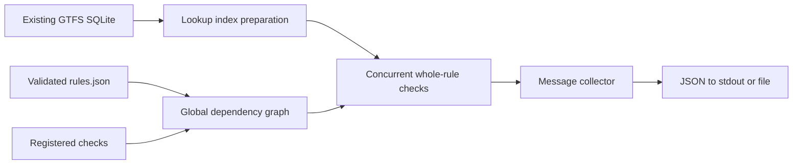

# GTFS Validator

A high-performance GTFS (General Transit Feed Specification) validation tool written in Go. The validator processes GTFS feeds, applies configurable validation rules, and reports errors and warnings in a structured format.

## Building the binary

Build and test this package directly:

```sh
cd packages-golang/validator
go build -o dist/validator ./src
go test -race ./...
```

The repository's `npm run repo:validator-binary` builds this package for the
TypeScript wrapper. `npm run build:binary --workspace=@tmlmobilidade/go-operation-validator`
also rebuilds the wrapper and is used by the worker's `predev` step.
Both commands use `packages-golang/validator/compile.sh`; the binary release
workflow uses the same script with `--all`.
The script clears the wrapper's `bin` and `dist/bin` directories and copies the
new executable to both. `--all` builds Linux and macOS binaries for amd64 and arm64.

The wrapper declares this Go package as a build dependency, so Turbo includes its
sources when pruning Docker builds and compiles it before building the wrapper.
Local builds also write `dist/validator` in this package. The wrapper copies that
artifact into its runtime `dist/bin` directory, including when Turbo restores the
Go build from cache.

Building a binary does not rebuild or deploy the worker image.

To run the rules in `rules.json` against a ZIP or an imported GTFS SQLite file:

```sh
cd packages-golang/validator
make dev INPUT=data/gtfs_20261021_TML.zip
# Or use an existing SQLite database:
make dev INPUT=/absolute/path/feed.sqlite
```

The Makefile lives at the package root. For ZIP input, it calls the
existing `import-gtfs` CLI first, then passes
its temporary SQLite database to the normal validator. The temporary database is
removed after the run; the input ZIP or existing SQLite file is retained.

This writes `src/output.json` using Portuguese messages and debug logging.
Override `RULES`, `OUTPUT`, `RULES_LANG`, or `LOG_LEVEL` as needed; relative paths
are resolved from the directory where you run make. Use `make run` with the same options to build and execute
`dist/gtfs-validator` instead.

## Architecture Overview

The GTFS Validator follows a modular, concurrent architecture designed for efficiency and extensibility. The system is organized into several key components:

### Core Components

1. **GTFS Loader** - Opens existing GTFS SQLite databases
2. **SQLite Queries** - Read imported data and prepare lookup indexes
3. **Validation Registry** - Manages registration and discovery of validation functions
4. **Rules Engine** - Processes configurable validation rules from JSON files
5. **Message Service** - Collects and aggregates validation results
6. **Validation Context** - Provides common utilities for validation functions

Shared data types and contracts live under `src/types`, grouped into `cli`,
`logger`, `messages`, `rules`, `algorithm`, `sqlite`, `geo`,
`context`, and `validations`. The `types` tree contains declarations only;
row-error behavior lives in `lib/context`, and report helpers live in
`lib/messages`. Query and execution logic stays in
`services` and `lib`. Service implementations that own methods and private state,
such as the logger and message collector, keep those together in their package.

Shared runtime variables live under `src/types/variables`: registry state,
severity settings, supported tables and codes, compiled regexes, string escaping,
and version values. Logger and translator instances live in its `logger` and
`i18n` subpackages to avoid import cycles. Per-call state remains local. The two
`go:embed` declarations stay beside the source files they embed.

Geometry follows the same boundaries: `lib/geo` contains the calculations,
`services/geo` loads shapes through the SQLite query helpers and owns one rule's
geometry caches, and `types/geo` holds the coordinate, point, and diagnostic
contracts. Geometry functions and types each have a focused file. Shared
thresholds live in `types/variables/geo.go`; custom-rule tolerance and unit options
are resolved in `validations/customs/utils`.

### High-Level Flow



## GTFS Loading Process

The validator accepts an existing SQLite database produced by [import-gtfs](../import-gtfs/).
Run the importer separately, then pass its output path with `-input /path/to/gtfs.db`.
The flow is `import-gtfs → SQLite → validator → validation results`.
The validator uses shared `telemetry` timing.
ZIP input is no longer supported by the validator.

`services/sqlite.ReadGTFSSQLite()` opens an existing regular file with `mode=rw`,
checks its SQLite schema, and returns a database connection. Missing paths are
rejected without creating a database. Imported rows remain on disk: query helpers
preserve TEXT values and expose NULL cells as empty strings. Preparation is
separate: `queries.PrepareSQLiteIndexes(db)` creates lookup indexes in one
transaction before concurrent checks start. Table and column existence are queried
directly from SQLite when needed; there is no shared schema cache or preload step.
Missing columns become SQL `NULL` in validation queries, and missing tables are
left for file-presence rules to report. The input must be writable and is retained
after validation; only the connection is closed.

The validator uses the pure-Go SQLite driver, so `CGO_ENABLED=0` remains supported.

## Logging

`src/services/logger` composes the shared telemetry logger with validator row
progress. Its shared instance is `types/variables/logger.AppLogger`, which supports
all telemetry severity methods, log-level filtering,
and performance trackers. Severity logs go to stderr so stdout can contain the
JSON result. `ENVIRONMENT=dev` selects readable logs; other environments use
structured JSON with timestamps and attributes. Shared presentation methods such
as `Divider` still write to stdout; the entrypoint uses `Info` for its banner.

```go
progress := logger.AppLogger.NewProgressTracker("trips", totalRows, 1000)
// Call after each processed row:
progress.Track()
// Call only after all table checks finish successfully:
progress.Complete()
```

Progress includes the table, processed rows, total rows, and completion status.
Reaching the final row does not report 100% until `Complete` is called. Progress
trackers accept concurrent row updates and normalize a zero row threshold to one.

## Validation Processing

`validations/main.go` orchestrates execution through one global Kahn dependency graph.
`validations/registry-rules.go` registers every whole-rule callback in `RegisterRules()`, with each rule ID beside its validation function. Each callback owns
its table selection, fields, and related-table requirements. Source discovery
reads the same registrations to validate IDs in `rules.json` separately.

The `validations` root contains the orchestrator in `main.go`, its tests in
`main_test.go`, and the registration list in `registry-rules.go`. Rule callback
execution and operational-failure helpers live in `lib/rules/execution`;
shared execution data stays in `types/validations`. The embedded source
declaration stays in `main.go` and includes the central registrations.

### Validation Execution Flow

1. Receive the database connection, validated configuration, and shared collector.
2. Select configured callbacks and their declared prerequisites from the registered
   checks and file-presence gates. Bind dependencies from `rules.json` into one graph.
3. Start every dependency-ready rule immediately. Each rule scans its complete
   source table in bounded batches; cursors close before check callbacks run.
4. On each completion, release dependents whose prerequisites passed. Info,
   warning, and error findings mark a rule failed; failed/skipped prerequisites block dependents.
   Independent rules continue without a table or ready-level barrier.
5. Wait for every started worker, then return `Result.Statuses` and `Result.Summary`.
   Runtime failures are added as technical findings and also returned as Go errors.

The scheduler has no rule concurrency limit. Rules share the database connection
pool and query its schema when needed. Each rule receives a private context before entering the graph. Its ID identifies
the node, and only `depends_on` controls when Kahn invokes its callback.

### Validation Function Signature

Every executable rule receives one context:

```go
func PatternIdField(ctx *context.ValidationContext) error {
    return context.ForEachRow(ctx, "trips", []string{"pattern_id"}, func(row *context.ValidationContext) error {
        // Read row.Source, use row.Config, and report through context.AddMessage.
        return nil
    })
}

func RegisterRules() {
    // In validations/registry-rules.go, register all callbacks in one batch:
    registry.Register(validationTypes.RuleChecks{
        "trips_pattern_id_field": fields.PatternIdField,
        "trips_shape_id_field":   fields.TripsShapeIdField,
    })
}
```

The rule selects its own source table, fields, and related tables. `ForEachRow`
reads bounded batches and releases its SQLite cursor before invoking callbacks,
so related-table queries also work with a single database connection. The
orchestrator returns findings in the report and operational failures through both
the report and error.

### Validation Context

`ValidationContext` contains the rule ID, complete configuration, database
connection, message receiver, and outcome. `Config.Severity` is the source used by
severity and reporting helpers. Each row callback receives a child context with
its own source location and copied configuration; row changes do not leak into
other rows or rules. Findings propagate to the parent outcome before Kahn
releases or blocks its dependents. Translation helpers use the context's rule ID.

## Results Collection and Output

### Message Service

The `MessageService` collects all validation messages throughout the execution:

- **Message Aggregation**: Messages are collected with metadata (file name, field, row numbers, severity)
- **Deduplication**: Findings with the same file, rule, field, severity, and text
  are merged, retaining at most 50 row examples: the first 49 source rows and the latest occurrence
- **Severity Tracking**: Counts distinct error and warning diagnostics in the report
- **Dependency Outcomes**: Counts every emitted info, warning, and error finding
  before deduplication so repeated findings still fail the rule

The shared collector interface exposes `AddMessage`, `GetSummary`, and
`RuleIssueCount`. The concrete collector also provides `OutputSummary` for the CLI.
Each run owns its collector, and report snapshots can be changed without changing
stored findings. `AllMessages` flattens grouped reports for callers such as tests.

### Output Formats

The validator supports multiple output formats:

1. **JSON Output**: Structured JSON output with all messages and summary statistics
2. **File Output**: Results can be written to a file using the `-out` flag
3. **Console Output**: Results are printed to console by default

### Message Structure

Each validation message contains:

- **RuleID**: Unique identifier for the validation rule
- **Message**: Human-readable error or warning message
- **Severity**: `info`, `warning`, or `error`; ignored findings are omitted and
  forbidden findings are reported as errors
- **FileName**: The GTFS file being validated
- **Field**: The specific field being validated
- **Rows**: Array of row numbers (1-indexed, accounting for header row) where the issue occurs

## Configuration

### Command-Line Options

- `-input`: Path to the GTFS SQLite database (required)
- `-rules`: Path to the validation rules JSON file (optional)
- `-out` / `-o`: Path to write output file (optional)
- `-log`: Log level (debug, info, error)
- `-lang`: Language for error messages (en, es, pt)

### Rules File Format

The rules file accepts a flat object keyed by rule ID, either directly or inside a `validation_rules` object. Partial configurations are supported; omitted rules and severities default to `ignore`. For example:

```json
{
  "validation_rules": {
    "trips_file_missing": {
      "severity": "error",
      "depends_on": []
    },
    "trips_shape_id_field": {
      "severity": "warning",
      "depends_on": ["trips_file_missing"]
    },
    "shapes_file_missing": {
      "severity": "error"
    },
    "trips_shape_id_foreign": {
      "severity": "error",
      "depends_on": ["trips_shape_id_field", "shapes_file_missing"]
    }
  }
}
```

`<file>_file_missing` checks whether the imported table exists. It enters the graph
when configured or referenced by `depends_on`, and it may itself have prerequisites.
Once those prerequisites pass, it passes when the table exists and fails when it
is missing, even when its diagnostic severity is `ignore` or its configuration
entry is omitted. Unconfigured, unreferenced presence checks do not run.

Each rule can have:

- **severity**: `ignore`, `info`, `warning`, `error`, or `forbidden`
- **options**: An array of allowed string values
- **compare**: An array of `{ "key": "field_name", "value": "expected_value" }` objects
- **depends_on**: Any rule IDs, including `<file>_file_missing`, that must pass before this rule runs

Explicit `depends_on` settings can refer to rules from any table. Scheduling follows
only those explicit dependencies. Checks also skip when their source or required
lookup tables are missing, even without a file-presence dependency. File-presence
rules control missing-file diagnostics; these local checks prevent queries against
unavailable tables. Dependencies are not added automatically.
Kahn's graph is built inside `validations/main.go`, before any checks execute.

Each prerequisite must finish and pass across its whole source table before its
dependents run. Info/warning/error findings, ignored rules, and missing required tables
block dependents; independent work continues. An empty source table produces no
row findings. Diagnostic-only IDs have no executable work and remain skipped when
used as prerequisites. File-presence gates use actual table existence independently
of whether their missing-file diagnostic is enabled.

Run `npm run repo:validator-rules` from the repository root or this package directory to generate only `packages-new/types/gtfs-validator/src/rules/rule-ids.ts`. The generator reads IDs from the central registrations; dependencies remain in `rules.json`.

Run `npm run repo:validator-rules -- --check` to check the committed catalog without
rewriting it. To inspect the generated catalog separately, run
`npm run repo:validator-rules -- /tmp/validator-rules`.

Rule-ID discovery has one entry point: `lib/rules/discover.DiscoverRuleIDs(fs.FS)`.
Rules JSON validation supplies the embedded `validations.RuleSources`; TypeScript
generation supplies `os.DirFS(sourceDir)`. Both use the same parsing, runtime IDs,
deduplication, and sorting. Standalone binaries do not need the Go source checkout,
and the generator still supports `--source-dir`.

Rules grouped by GTFS file are rejected. Configuration is a map from rule ID to
`rules.RuleConfig`: `trips_pattern_id_field` is read directly, without a `trips`
section or a `trips.` prefix. Each check receives only its own context. Use
`ignore` to disable a rule. The generated list's technical diagnostic IDs,
including `file_validation` and `file_not_found_in_rules`, are accepted as flat
entries, but their runtime severities remain fixed.

## Performance Considerations

- **Concurrent Validations**: Every rule starts when its configured prerequisites pass
- **Bounded Reads**: Source rows are buffered in batches of 512, with cursors closed
  before callbacks perform related-table queries
- **Indexed Lookups**: Lookup indexes are prepared before concurrent checks start
- **Progress Tracking**: Rules log their start, progress, final status, and duration

## Cleanup

After validation completes, results are written to stdout or the configured file
and the SQLite connection is closed. The supplied database is retained.
