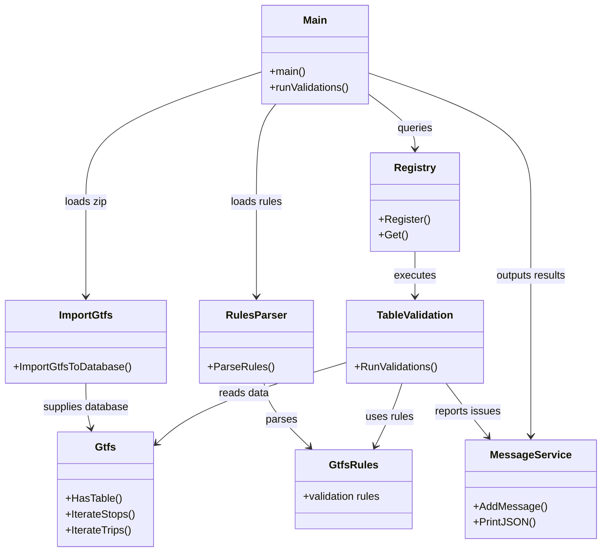

# GTFS Validator

A high-performance GTFS (General Transit Feed Specification) validation tool written in Go. The validator processes GTFS feeds, applies configurable validation rules, and reports errors and warnings in a structured format.

## Building the binary

From the repository root, `npm run repo:validator-binary` builds for the current
machine. It uses `compile.sh` (default: `--local`), clears `ts-wrapper/bin` and
`ts-wrapper/dist/bin`, and writes the executable to both directories. Go is required.

To build all four release binaries (Linux and macOS, amd64 and arm64), run:

```sh
bash modules/operation/apps/validator/validator/compile.sh --all
```

Starting the worker with `npm run dev:operation:gtfs-validator` automatically runs
`compile.sh` through the worker's `predev` hook before starting the Node process.

For previews and other deployments, the module build workflow sets up Go and runs
the same `compile.sh` before building the worker image. The shared Node Dockerfile
copies the binary explicitly, because Turbo prune excludes ignored binaries,
and refreshes the wrapper's `dist/bin` after the TypeScript build. Kubernetes
starts the worker with the binary already present. Rebuild the worker image to
deploy Go changes; no app-specific Dockerfile is needed.

For a manual Docker build, compile the image platform's binary first. Use
`compile.sh --all` when the image platform differs from the host. A missing binary
for the image platform causes the Docker build to fail.

## Architecture Overview

The GTFS Validator follows a modular, concurrent architecture designed for efficiency and extensibility. The system is organized into several key components:

### Core Components

1. **GTFS Loader** - Handles reading and parsing GTFS zip files
2. **SQLite Storage** - Stores GTFS data in a temporary SQLite database for efficient access
3. **Validation Registry** - Manages registration and discovery of validation functions
4. **Rules Engine** - Processes configurable validation rules from JSON files
5. **Message Service** - Collects and aggregates validation results
6. **Validation Context** - Provides common utilities for validation functions

### High-Level Flow

```
GTFS Zip File → SQLite Import → File Validation → Table Validations (Concurrent) → Results Output
```

### Architecture Diagram



## GTFS Loading Process

The validator loads feeds through the shared [import-gtfs](../import-gtfs/) package.
SQLite remains the storage layer for validation queries. The validator supplies
its existing pure-Go connection, so `CGO_ENABLED=0` builds remain supported.
The shared packages require Go 1.26 or newer.

### Step 1: Zip File Reading

The process begins when `ReadGTFSZip()` is called with a path to a GTFS zip file:

1. **Temporary Database Creation**: The validator creates a temporary database and supplies its connection to `ImportGtfsToDatabase`.
2. **Database Configuration**: The shared importer configures WAL, synchronous writes, memory temporary storage, and a single connection during import. After import, the validator restores the connection pool for nested and concurrent validation queries.

### Step 2: File Processing

Each file in the GTFS zip archive is processed sequentially:

1. **File Filtering**: Standard GTFS `.txt` files and the validator's registered table names are imported. This includes TML extensions such as `vehicles`, `municipalities`, `archives`, `periods`, and `afetacao`. Unrecognized files are ignored. Nested ZIP folders are supported.
2. **CSV Parsing**: The shared importer streams CSV rows, handles UTF-8 BOMs and multiline quoted fields, and uses the header to define `TEXT` columns, including custom fields.
3. **Transactional Import**: All rows are imported in one transaction. Malformed CSV or SQL errors fail the import and roll it back. Empty cells become SQL `NULL`; whitespace and leading zeros are preserved. No date filter is applied, so validation sees the original service dates.
4. **ID Mapping**: After import, the validator builds its `id_map` from the imported tables, retaining duplicate IDs, per-field composite-key lookups, and zero-based source row indices. Missing ID columns remain available for field validation to report.
5. **Cleanup**: Failed imports close the connection and remove temporary database files. Successful imports remain open until validation finishes, when the database and any WAL/SHM sidecars are removed.

### Step 3: Data Structure Creation

After all files are imported:

1. **Gtfs Struct**: A `Gtfs` struct is created with a connection to the SQLite database
2. **ID Map Loading**: The ID map is loaded into memory for fast primary key lookups
3. **Iterator Methods**: The `Gtfs` struct provides iterator methods (e.g., `IterateStops()`, `IterateTrips()`) that stream data from SQLite

### Benefits of SQLite Storage

- **Memory Efficiency**: Large feeds don't need to be fully loaded into memory
- **Fast Queries**: SQLite provides efficient querying and indexing
- **Concurrent Access**: Multiple validations can read from the database concurrently
- **Temporary Storage**: The database is automatically cleaned up after validation completes

## Validation Processing

The validation system uses a registry pattern that allows validation functions to be registered and discovered automatically.

### Validation Registry

The `validations.Registry` maintains a thread-safe map of table names to validation functions:

- **Registration**: Each validation package registers itself during `init()` using `validations.Register(tableName, validationFunction)`
- **Discovery**: The main validation loop looks up validation functions by table name
- **Thread Safety**: The registry uses read-write mutexes to support concurrent access

### Validation Execution Flow

1. **Rules Parsing**: Validation rules are loaded from a JSON file (if provided) and parsed into a `GtfsRules` structure
2. **File Validation**: Basic file-level validations run first (required files, forbidden files, conditional requirements)
3. **Table Validation**: For each GTFS table:
   - Check if the table exists in the database
   - Look up the registered validation function
   - Execute the validation function in a separate goroutine
4. **Concurrent Execution**: All table validations run concurrently using goroutines and a `sync.WaitGroup`
5. **Completion**: The system waits for all validations to complete before proceeding

### Validation Function Signature

Each validation function follows this signature:

```go
func(gtfs types.Gtfs, rules *types.GtfsRules)
```

- **gtfs**: Provides access to the GTFS data via iterator methods and database queries
- **rules**: Contains the validation rules for the specific table being validated

### Validation Context

The `ValidationContext` struct provides common utilities for validation functions:

- **Severity Management**: Checks if a validation should be ignored or if a field is forbidden
- **Message Creation**: Standardized message creation with proper formatting
- **Translation Support**: Access to internationalized error messages
- **Row Tracking**: Tracks which rows have validation issues

## Results Collection and Output

### Message Service

The `MessageService` collects all validation messages throughout the execution:

- **Message Aggregation**: Messages are collected with metadata (file name, field, row numbers, severity)
- **Deduplication**: Duplicate messages are merged, keeping track of all affected rows
- **Severity Tracking**: Maintains counts of errors and warnings
- **Early Exit**: Can exit early if too many issues are detected (configurable limit)

### Output Formats

The validator supports multiple output formats:

1. **JSON Output**: Structured JSON output with all messages and summary statistics
2. **File Output**: Results can be written to a file using the `-out` flag
3. **Console Output**: Results are printed to console by default

### Message Structure

Each validation message contains:

- **ValidationID**: Unique identifier for the validation rule
- **Message**: Human-readable error or warning message
- **Severity**: ERROR, WARNING, or IGNORE
- **FileName**: The GTFS file being validated
- **Field**: The specific field being validated
- **Rows**: Array of row numbers (1-indexed, accounting for header row) where the issue occurs

## Configuration

### Command-Line Options

- `-input`: Path to the GTFS zip file (required)
- `-rules`: Path to the validation rules JSON file (optional)
- `-out` / `-o`: Path to write output file (optional)
- `-log`: Log level (debug, info, error)
- `-lang`: Language for error messages (en, es, pt)

### Rules File Format

The rules file accepts a flat object keyed by rule ID, either directly or inside a `validation_rules` object. Partial configurations are supported; omitted rules and severities default to `ignore`. For example:

```json
{
  "validation_rules": {
    "agency_file_missing": {
      "severity": "error",
      "depends_on": []
    },
    "agency_id_unique": {
      "severity": "warning",
      "depends_on": ["agency_file_missing"]
    }
  }
}
```

`<group>_file_missing` configures the file-presence severity previously stored as `<group>._file` and is a valid prerequisite for rules in that group. It passes when the table exists and fails when it is missing, even when its severity is `ignore` or its configuration entry is omitted. File-presence rules have no prerequisites.

Each rule can have:

- **severity**: `error`, `warning`, `info`, `ignore`, or `forbidden`
- **options**: An array of allowed string values
- **compare**: An array of `{ "key": "field_name", "value": "expected_value" }` objects
- **depends_on**: Rule IDs from the same file, including `<file>_file_missing`, that must pass before this rule runs

Dependencies come only from `depends_on` in the supplied rules JSON. Omitting it or supplying an empty array means the rule has no prerequisites. Unknown dependencies, cycles, and dependencies on incompatible execution phases are rejected before the GTFS is imported. Execution scopes are declared in `lib/rules/scopes.go`; they do not add dependencies.

Run `npm run repo:validator-rules` to generate only `packages-new/types/gtfs-validator/src/rules-new/rule-ids.ts`. The generator reads IDs from the validation implementations; it does not generate a catalogue or define dependencies.

Rules grouped by GTFS file are rejected. The runtime stores `types.GtfsRules` as a map from rule ID to `types.RuleContext`: `agency_id_unique` is read directly, without an `agency` section or an `agency.` prefix. Each check receives only its own context, for example `AgencyEmailField(db, rules.Rule("agency_email_field"))`. Use `ignore` to disable a rule. The generated list's technical diagnostic IDs, including `file_validation` and `file_not_found_in_rules`, are accepted as flat entries, but their runtime severities remain fixed.

## Performance Considerations

- **Concurrent Validations**: Table validations run concurrently to maximize CPU utilization
- **Streaming Access**: Data is streamed from SQLite rather than loaded entirely into memory
- **Batch Processing**: Database operations use batch transactions
- **Early Termination**: Can exit early if too many validation errors are detected
- **Progress Tracking**: Large tables show progress indicators during validation

## Cleanup

After validation completes:

1. The SQLite database connection is closed
2. The temporary database file is removed
3. Results are output in the requested format

This ensures no temporary files are left behind after validation completes.
